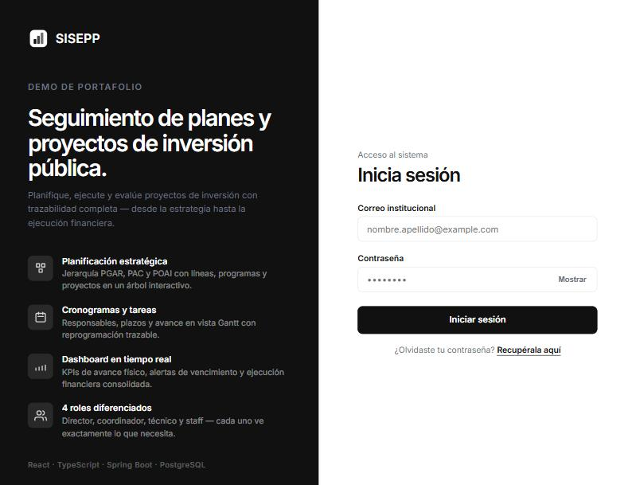

# SISEPP — Sistema de Seguimiento a Planes y Proyectos de Inversión Pública

<p align="center">
  
  
  
  
  
  
  
  
  
  
</p>

> **Demo de portafolio con datos ficticios.** No está afiliado a ninguna entidad gubernamental. Licencia MIT.

<p align="center">
  
</p>

---

## Qué es SISEPP

Plataforma web **fullstack** para la **planificación, seguimiento y evaluación de proyectos de inversión pública**. Diseñada pensando en los usuarios finales — directores, coordinadores y técnicos — que necesitan gestionar el ciclo completo de un plan de inversión: desde la definición estratégica hasta el seguimiento mensual de avance y la ejecución financiera, todo en una sola interfaz.

### El problema

Las entidades públicas manejan decenas de proyectos simultáneos con presupuestos asignados, cronogramas estrictos y múltiples responsables. Sin una herramienta centralizada, el seguimiento se fragmenta en hojas de cálculo, correos y reportes manuales — generando pérdida de trazabilidad, retrasos no detectados y ejecución presupuestal sin visibilidad en tiempo real.

### La solución

SISEPP centraliza la gestión en una plataforma con **roles diferenciados**, **trazabilidad completa** y **reportes consolidados**. La experiencia de usuario fue diseñada para que cada rol vea exactamente lo que necesita: el director tiene el panorama completo, el coordinador gestiona sus proyectos asignados y el técnico registra avances sin fricción.

---

## Desarrollo asistido por IA

Este proyecto fue desarrollado con **programación activa asistida por IA** (Claude). La IA participó como copiloto en:

- **Diseño de la arquitectura** hexagonal y definición de boundaries entre módulos
- **Generación y revisión de código** con iteración continua sobre la calidad
- **Modelado de datos** relacional con constraints, índices y relaciones complejas
- **Diseño de la API REST** siguiendo convenciones RESTful y buenas prácticas
- **Sistema de diseño** CSS con design tokens y componentes Atomic Design
- **Configuración de CI/CD**, Docker Compose y seguridad (escaneo de secretos con gitleaks)
- **Testing** de integración con Testcontainers
- **Documentación técnica** del proyecto

El flujo de trabajo combinó criterio humano de diseño y arquitectura con la productividad de la IA para generar, iterar y refinar código — manteniendo siempre el control sobre las decisiones de diseño y la calidad del resultado.

---

## Stack Técnico

### Backend — Java 17 / Spring Boot 3.3

| Tecnología | Uso |
|---|---|
| **Spring Boot 3.3.2** | Framework principal, configuración auto, embedded Tomcat |
| **Spring Security + JWT** | Autenticación stateless, lockout por intentos fallidos, BCrypt |
| **Spring Data JPA / Hibernate** | ORM, queries derivadas, relaciones complejas (auto-referenciales, N:M) |
| **Spring Validation** | Validación declarativa con Jakarta Bean Validation en DTOs |
| **Spring Mail** | Correos transaccionales (reset de contraseña, notificaciones) |
| **PostgreSQL 14+** | Base de datos relacional (SQL), constraints CHECK, extensión pgcrypto |
| **Flyway** | 29 migraciones versionadas, perfiles separados para datos de prueba |
| **Testcontainers** | Tests de integración con PostgreSQL real en Docker (no mocks) |
| **SpringDoc OpenAPI** | Documentación interactiva Swagger UI auto-generada |
| **Lombok** | Reducción de boilerplate (builders, getters, constructors) |
| **Docker Compose** | Orquestación de servicios para despliegue |

### Frontend — React 18 / TypeScript 5.5 / Vite

| Tecnología | Uso |
|---|---|
| **TypeScript 5.5 (strict)** | Tipado estático completo, interfaces alineadas 1:1 con DTOs del backend, union types como enums |
| **React 18.3** | UI declarativa con hooks (`useState`, `useEffect`, `useContext`, `useCallback`) |
| **Vite 5.4** | Bundler con HMR instantáneo, build optimizado con tree-shaking |
| **React Router DOM 6** | Routing declarativo, rutas protegidas por rol, redirección por perfil |
| **Axios** | Cliente HTTP con interceptors para JWT y manejo centralizado de errores 401 |
| **Vanilla CSS + Design Tokens** | Sistema de diseño propio sin frameworks CSS externos |

### Infraestructura y DevOps

| Herramienta | Uso |
|---|---|
| **Git + GitHub** | Control de versiones, branching, pull requests |
| **GitHub Actions** | CI/CD: build + tests backend (Ubuntu/Linux), build + type-check frontend |
| **Docker + Docker Compose** | Contenedorización y orquestación para despliegue |
| **gitleaks** | Escaneo automatizado de secretos en el repositorio |
| **Linux (Ubuntu)** | Entorno de CI y despliegue de producción |

---

## Diseño UX y Sistema de Diseño

### Enfoque centrado en el usuario

La interfaz fue diseñada pensando en los distintos perfiles de usuario y sus necesidades:

- **Director**: dashboard con árbol consolidado de toda la estructura PAC, visión 360° de proyectos y ejecución financiera
- **Coordinador**: vista filtrada a sus proyectos asignados, gestión de tareas y cronogramas
- **Técnico**: interfaz simplificada para registrar avances mensuales de sus tareas asignadas

Cada rol tiene su **página de inicio diferenciada** (`HOME_BY_ROLE`) y solo ve las funcionalidades que le corresponden, reduciendo la complejidad cognitiva.

### Sistema de diseño propio (sin frameworks CSS)

Se construyó un **sistema de diseño desde cero** con Vanilla CSS, sin dependencias de Tailwind, Bootstrap ni CSS-in-JS:

- **Design tokens** centralizados en `tokens.css`: colores, tipografía, radios, sombras, espaciado
- **Componentes Atomic Design** organizados en 4 capas:

| Capa | Componentes | Ejemplos |
|---|---|---|
| **Atoms** | 10 | Button, Input, Select, Badge, Avatar, Icon, StatusBadge |
| **Molecules** | 8 | FormField, Alert, PasswordField, TreeRow, SdgCheckboxGroup |
| **Organisms** | 15+ | PacTreeTable, FinancialTable, GanttView, LoginForm, Navbar |
| **Templates** | 2 | AuthLayout (público), DashboardLayout (autenticado) |

- **Nomenclatura por capa**: `atom-btn`, `molecule-field`, `organism-table-card` — consistencia y escalabilidad
- **Paleta monocromática neutra** con tokens semánticos reutilizables
- **18 páginas** con navegación protegida por roles

---

## Diseño de la API REST

### Principios de diseño

La API sigue **buenas prácticas RESTful** consistentes en los 40+ endpoints:

- **Recursos como sustantivos** en rutas (`/users`, `/tasks`, `/follow-ups`), verbos HTTP para acciones
- **Versionado explícito** bajo `/api/v1/`
- **DTOs separados** para Request y Response (nunca se exponen entidades JPA)
- **Validación declarativa** con Jakarta Bean Validation en cada Request DTO
- **Manejo de errores centralizado** con respuestas estructuradas y códigos HTTP semánticos
- **Documentación auto-generada** con SpringDoc OpenAPI / Swagger UI

### Endpoints por módulo

| Módulo | Endpoints | Roles | Operaciones |
|---|---|---|---|
| **Autenticación** | `/auth/*` | Público | Login JWT, forgot/reset password |
| **Usuarios** | `/users/*` | DIR, ADM | CRUD, activar/desactivar, filtros |
| **Instrumentos** | `/planning-instruments/*` | DIR | PGAR, PAC, POAI (jerarquía) |
| **Estructura** | `/structure/*` | DIR, COO, ADM | Líneas, programas, proyectos, actividades |
| **Tareas** | `/tasks/*` | DIR, COO, ADM | CRUD, reprogramación con trazabilidad |
| **Seguimiento** | `/follow-ups/*` | COO, TEC | Avance mensual por tarea |
| **Financiero** | `/financial-executions/*` | DIR, COO | Ejecución presupuestal |
| **Dashboard** | `/structure/tree` | Autenticado | Árbol consolidado por vigencia |

---

## Arquitectura

### Backend — Hexagonal (Ports & Adapters)

El backend implementa **arquitectura hexagonal** con separación estricta entre dominio, aplicación e infraestructura. Cada módulo de negocio es independiente y se comunica a través de puertos definidos — nunca accede directamente a la persistencia de otro módulo.

```
dev.demo.sisepp
├── auth/                  # Autenticación, JWT, reset de contraseña
├── usuarios/              # CRUD de usuarios con 4 roles
├── planificacion/         # Instrumentos: PGAR → PAC → POAI
├── catalogo/              # Líneas estratégicas, indicadores ODS
├── programas/             # Programas del PAC
├── proyectos/             # Proyectos + asignación de coordinadores
├── actividades/           # Actividades + metas anuales
├── tareas/                # Tareas, cronograma, reprogramación
├── seguimiento/           # Seguimiento mensual con evidencia
├── financiero/            # Ejecución financiera por proyecto
├── estructura/            # Árbol consolidado PAC (dashboard)
└── shared/                # Excepciones globales, enums, TraceIdFilter
```

Estructura interna de cada módulo:

```
domain/
  model/                   # Records inmutables (value objects, DDD)
  port/input/              # Use cases (interfaces)
  port/output/             # Repository ports (interfaces)
application/
  dto/                     # Request / Response DTOs
  service/                 # Implementación de use cases
infrastructure/
  input/rest/              # Controllers REST
  output/persistence/      # JPA entities, adapters, mappers
```

**263 clases Java** en **13 módulos de dominio** con boundaries claros.

### Frontend — Atomic Design + Feature-based

```
src/
  api/                     # Cliente HTTP por contexto (7 módulos API)
  context/                 # AuthContext (JWT, roles, sesión)
  design-system/           # Sistema de diseño Atomic (atoms → templates)
  pages/                   # 18 páginas conectadas a rutas
  routes/                  # ProtectedRoute con validación de roles
  styles/                  # Design tokens + estilos globales
  types/                   # Interfaces TypeScript alineadas con DTOs
  utils/                   # Helpers (manejo centralizado de errores)
```

**66 componentes React/TypeScript** con sistema de diseño propio.

---

## Modelado de Datos (SQL)

Diseño relacional con **15+ tablas**, constraints CHECK, índices en FK y relaciones auto-referenciales:

```
planning_instruments (auto-referencial)
  PGAR (parent = null)
  └── PAC (parent → PGAR)
        └── POAI (parent → PAC)

strategic_lines → PGAR
  └── programs → strategic_line + PAC
        └── projects → program + PAC
              ├── project_coordinators (N:M con users)
              ├── activities → project
              │     ├── activity_annual_goals
              │     ├── activity_sdg_indicators (N:M)
              │     └── tasks → activity
              │           ├── task_schedules
              │           ├── task_reschedules
              │           └── follow_ups
              └── financial_executions
```

El modelo refleja la jerarquía real de planificación pública colombiana. **29 migraciones Flyway** versionadas con separación entre schema de producción (`db/migration`) y datos de prueba (`db/seed-dev`) mediante perfiles de Spring.

---

## Funcionalidades

### Planificación Estratégica
- Jerarquía de instrumentos: **PGAR → PAC → POAI** (relación auto-referencial)
- Líneas estratégicas alineadas a **17 Indicadores ODS**
- Árbol consolidado navegable desde un dashboard

### Gestión de Proyectos y Tareas
- Proyectos con asignación de coordinadores (relación N:M)
- Actividades con **metas anuales cuantificables**
- Tareas con cronograma y **reprogramación con trazabilidad**
- **Vista Gantt** para visualización de cronogramas
- Catálogo y consulta de tareas con filtros avanzados

### Seguimiento y Reportes
- Seguimiento mensual con registro de avance porcentual
- Ejecución financiera por proyecto (presupuesto vs. ejecutado)
- Reportes consolidados con exportación
- Tracking de metas vs. ejecución real

### Seguridad
- **4 roles** con permisos granulares: Director, Administrador, Coordinador, Técnico
- JWT stateless con expiración configurable (8h default)
- Lockout automático tras 5 intentos fallidos (15 min)
- Fail-fast: la aplicación **no arranca** sin un JWT secret de al menos 256 bits
- Reset de contraseña por email con token temporal
- Passwords hasheados con BCrypt

---

## Testing

- **Tests de integración** con **Testcontainers**: PostgreSQL real ejecutándose en **Docker**, no mocks
- `IntegrationTestBase` como clase base que configura el contenedor y el contexto Spring
- Tests end-to-end del ciclo de vida: creación de estructura → asignación → seguimiento
- CI ejecuta los tests en cada push a `main` (**GitHub Actions**, runner **Linux/Ubuntu**)

---

## CI/CD — GitHub Actions

Dos workflows independientes con **path filters** para builds eficientes:

| Workflow | Stack | Acciones |
|---|---|---|
| **Backend CI** | JDK 17, Ubuntu (Linux) | Compilar con Maven + ejecutar tests con Testcontainers/Docker |
| **Frontend CI** | Node.js 20, Ubuntu (Linux) | Instalar dependencias + type-check TypeScript + build Vite |

Ambos se ejecutan en push y PR a `main`, filtrados por paths para evitar builds innecesarios.

---

## Decisiones de Diseño

| Decisión | Justificación |
|---|---|
| **Arquitectura hexagonal** | Desacoplar lógica de negocio de la infraestructura; facilita testing y cambio de implementaciones |
| **Records inmutables (DDD)** | Prevenir mutación accidental en el dominio |
| **TypeScript strict** | Detectar errores en tiempo de compilación, no en producción |
| **Design system propio** | Control total del UX sin lock-in de frameworks CSS |
| **Atomic Design** | Reutilización consistente y escalable de componentes UI |
| **API RESTful con DTOs** | Nunca exponer entidades JPA; contrato claro entre frontend y backend |
| **JWT stateless** | Escalabilidad horizontal sin estado de sesión en servidor |
| **Flyway con perfiles** | Separar datos de prueba del schema de producción |
| **Testcontainers** | Tests contra PostgreSQL real, no contra mocks que ocultan bugs |
| **Desarrollo con IA** | Productividad + iteración rápida manteniendo control sobre la calidad |

---

## Cómo Ejecutar

### Requisitos

- Java 17+ / Node.js 18+ / PostgreSQL 14+ / Docker

### Backend

```bash
cd backend

# Variables de entorno (ver .env.piloto.example)
export SISEPP_DB_PASS='<contraseña>'
export SISEPP_JWT_SECRET="$(openssl rand -base64 48)"
export SPRING_PROFILES_ACTIVE=dev
export SISEPP_SEED_PASSWORD='<contraseña para usuarios de prueba>'

./mvnw spring-boot:run    # → http://localhost:8081
```

Flyway aplica las migraciones automáticamente. Swagger UI en `/swagger-ui.html`.

### Frontend

```bash
cd frontend
npm install
cp .env.example .env
npm run dev               # → http://localhost:5173
```

### Usuarios de prueba

| Rol | Email | Contraseña |
|---|---|---|
| Director | `director@example.com` | la de `SISEPP_SEED_PASSWORD` |
| Coordinador | `coordinador@example.com` | idem |
| Técnico | `tecnico@example.com` | idem |

---

## Estructura del Repositorio

```
sisepp-demo/
├── .github/workflows/       # CI: backend-ci.yml, frontend-ci.yml
├── backend/                  # API REST — 263 clases Java, hexagonal, 13 módulos
│   ├── src/main/java/        # Código fuente
│   ├── src/main/resources/   # Config, 29 migraciones Flyway, Postman collection
│   ├── src/test/             # Tests de integración (Testcontainers)
│   ├── docker-compose.piloto.yml
│   └── pom.xml
├── frontend/                 # SPA — 66 componentes React/TypeScript
│   ├── src/                  # Código fuente (Atomic Design)
│   ├── public/
│   ├── package.json
│   └── vite.config.ts
├── LICENSE                   # MIT
└── README.md
```

---

## Licencia

MIT License — Ver [LICENSE](LICENSE).
